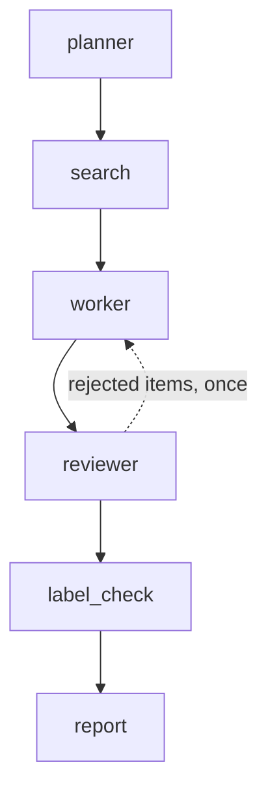

# Drug Safety Review with Multi-Agent LLMs and a LoRA Fine-Tuned Extractor

I fine-tuned a small open model (Qwen2.5-0.5B) with LoRA to pull adverse drug events out of real PubMed case reports. Then I used it as the worker inside a planner / worker / reviewer workflow (LangGraph) that reads the case reports for a drug, checks every finding in code, and compares it with the drug's FDA label.

Everything runs on free CPU runners in GitHub Actions. All numbers below come from [`results/`](results).

## Key results

**Fine-tuning beat prompting, RAG, and a 3x larger model** on 600 held-out test sentences (300 with an adverse event, 300 without):

| Method | Pair F1 (exact) | Pair F1 (overlap) | Precision | Recall | ADE sentence F1 | Valid JSON | Prompt tokens | Median s / sentence |
|---|---|---|---|---|---|---|---|---|
| Prompting (0.5B, instruction only) | 0.293 | 0.463 | 0.269 | 0.322 | 0.725 | 77.7% | 121 | 3.1 |
| RAG few-shot (0.5B + 4 retrieved examples) | 0.362 | 0.495 | 0.310 | 0.434 | 0.721 | 76.5% | 298 | 3.6 |
| RAG few-shot, 3x larger model (1.5B + 4 retrieved examples) | 0.467 | 0.579 | 0.384 | 0.594 | 0.780 | 80.2% | 298 | 13.4 |
| **LoRA fine-tuned (0.5B, instruction only)** | **0.667** | **0.759** | **0.643** | **0.693** | **0.901** | **99.5%** | 121 | **1.8** |

- Exact pair F1 went from 0.29 (prompting) to 0.67, more than double. It is also 0.20 higher than a model three times larger that gets retrieved worked examples.
- The fine-tuned model almost always answers in the right format (99.5% valid JSON vs 77 to 80%), and it is the fastest. Its prompts are less than half as long as the RAG prompts, and it writes short answers instead of extra text.
- Only 1.75% of the weights were trained (8.8M of 503M). Training took 136 minutes on a 4-core CPU: 3,000 sentences, 1 epoch, 375 steps. Validation loss fell from 0.514 to 0.086.

**The agent workflow** answered 20 questions about the 15 drugs with the most labeled events in the test sentences (15 single-drug questions and 5 that compare two drugs):

| What I measured | Result |
|---|---|
| Planner picked exactly the right drugs | 20 of 20 questions (all valid JSON) |
| Extraction for the drug under review, before the reviewer | precision 0.735, recall 0.807, F1 0.769 |
| After the reviewer and one retry | precision 0.770, recall 0.802, F1 0.786 |
| Items the reviewer rejected | 11, in 9 of 20 questions, each sent once for a second opinion |
| FDA label found on openFDA | 12 of 15 drugs |
| Distinct effects reported / not found on the label | 182 / 76 (flagged for human review) |
| Median time per question | 48 seconds, CPU only |
| Trace events written | 543 |

When to fine-tune, from this project: when the task has a fixed output format, you have a few thousand labeled examples, and you need a small model to be cheap and fast. Here RAG helped the base model a little (+0.07 F1), but it could not teach a 0.5B model the format and the labeling rules the way training did.

## Data

- **ADE Corpus V2** (Gurulingappa et al., 2012): sentences from PubMed case reports. Experts marked whether each sentence describes an adverse drug event, and marked the drug and effect spans. Loaded from Hugging Face (`ade-benchmark-corpus/ade_corpus_v2`). It has 6,821 drug/effect pairs and 23,516 labeled sentences.
- **openFDA drug labels** (api.fda.gov): the boxed warning, warnings, precautions, contraindications and adverse reactions sections. These are cached in [`data/fda_labels`](data/fda_labels).

Sentences are split into train, validation and test by a hash of the text, so the same sentence is never in two splits. The training sample has 3,000 sentences (2,000 with an event), and the test sample has 600 (300 with an event, 466 pairs). The agents search all 3,118 test-split sentences. Counts are in [`results/data_stats.json`](results/data_stats.json).

## How it works

### Fine-tuning ([`src/drugsafety/finetune.py`](src/drugsafety/finetune.py))

- Task: given one sentence, answer with a JSON list `[{"drug": ..., "effect": ...}]`, copying the spans from the sentence, or `[]`.
- LoRA rank 16, alpha 32, on all attention and MLP projections. Learning rate 2e-4 with warmup and cosine decay, batch size 8.
- The loss covers only the answer tokens, not the instruction or the sentence.
- `--qlora` loads the base model in 4-bit (bitsandbytes) on a CUDA GPU. This lets a 1.5B to 7B model fit on a free Colab or Kaggle T4.
- The trained adapter is published as a GitHub release.

### Fair comparison ([`scripts/run_eval.py`](scripts/run_eval.py))

All four methods use the same instruction, the same JSON format, greedy decoding and the same test sentences. RAG retrieves the 4 most similar labeled training sentences by TF-IDF, always including at least one sentence with no event. Scores:
- **Exact**: drug and effect both match after lowercasing and removing punctuation.
- **Overlap**: one span contains the other (for example "pneumonitis" vs "interstitial pneumonitis").
- **ADE sentence F1**: did the model find any event in a sentence that has one?

### Agents ([`src/drugsafety/agents/graph.py`](src/drugsafety/agents/graph.py))



- **Planner** (Qwen2.5-1.5B, prompted): turns the question into a plan, `{"drugs": [...], "check_label": true}`. Code checks the plan, and a drug name that is not in the question is dropped.
- **Search**: finds the case report sentences that mention each drug.
- **Worker** (the fine-tuned 0.5B model): extracts (drug, effect) pairs from each sentence.
- **Reviewer** (code, not a model): rejects invalid JSON, spans that are not copied from the sentence, and an effect that is just the drug name. Rejected sentences go back once to a second-opinion worker: the base model with retrieved worked examples.
- **Label check**: looks up the drug's FDA label and marks each effect as on or not on it.
- **Report**: groups effects, counts the sentences behind each one, and quotes the evidence.

Every node call is written to [`traces/agent_trace.jsonl`](traces/agent_trace.jsonl), with its inputs, outputs, model, prompt size and time in ms. Example reports are in [`results/sample_reports.md`](results/sample_reports.md).

## Limitations

- "Not on label" uses word matching (an exact phrase, or every content word by its first 6 letters). A synonym the label uses instead ("hemorrhage" for "bleeding") is missed, so 76 flags means 76 items for a person to check. It is not 76 new safety signals.
- 3 of 15 drugs had no label match on openFDA, because the corpus wrote them as "MTX", "L-asparaginase" or "interferon alpha". A name normalizer (for example RxNorm) would fix this.
- The reviewer raised precision by 3.5 points and cost 1 true pair. Its checks are strict on format, not on medical meaning.
- Sentences from the same paper can land in different splits, so test sentences are not fully independent of training.
- Expert labels exist for single sentences only, so the agent scores cover the sentences that the search step found.

## How to run

```
pip install torch --index-url https://download.pytorch.org/whl/cpu
pip install -e ".[dev]"
pytest -q                                          # 12 tests, including a LoRA run on a tiny random model
python scripts/train.py --time-budget-min 270      # LoRA on CPU (about 2 h 15 m on 4 cores)
python scripts/run_eval.py --method finetuned      # or zero_shot, rag, rag_1_5b; --shard i/n to split
python scripts/merge_eval.py
python scripts/run_agents.py
```

On a free GPU: `pip install -e ".[gpu]"` and `python scripts/train.py --qlora --model Qwen/Qwen2.5-1.5B-Instruct`.

The full run is [`.github/workflows/train-eval.yml`](.github/workflows/train-eval.yml): training, 16 sharded evaluation jobs and the agent run in parallel, then a merge job that commits the results and publishes the adapter. Start it from the Actions tab, or by changing `run-request.txt`.

## Stack

Python, PyTorch, Hugging Face Transformers, PEFT (LoRA / QLoRA), LangGraph, scikit-learn, openFDA API, GitHub Actions.
